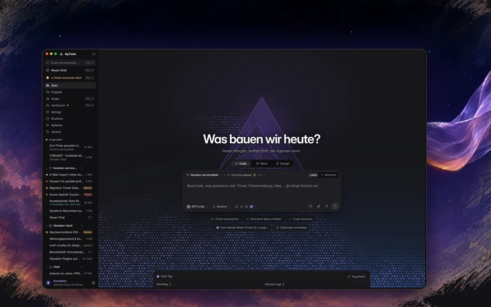
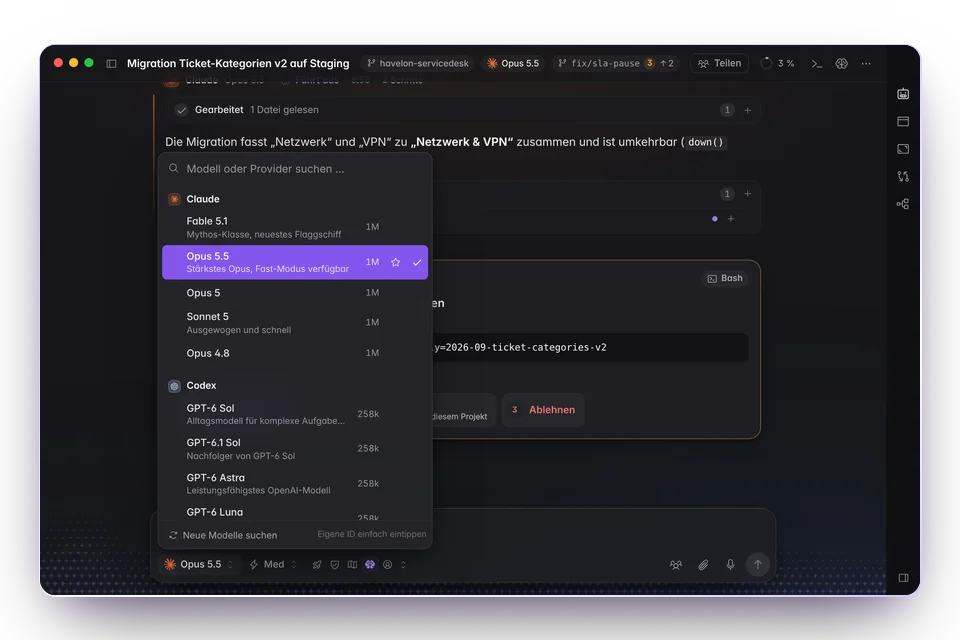
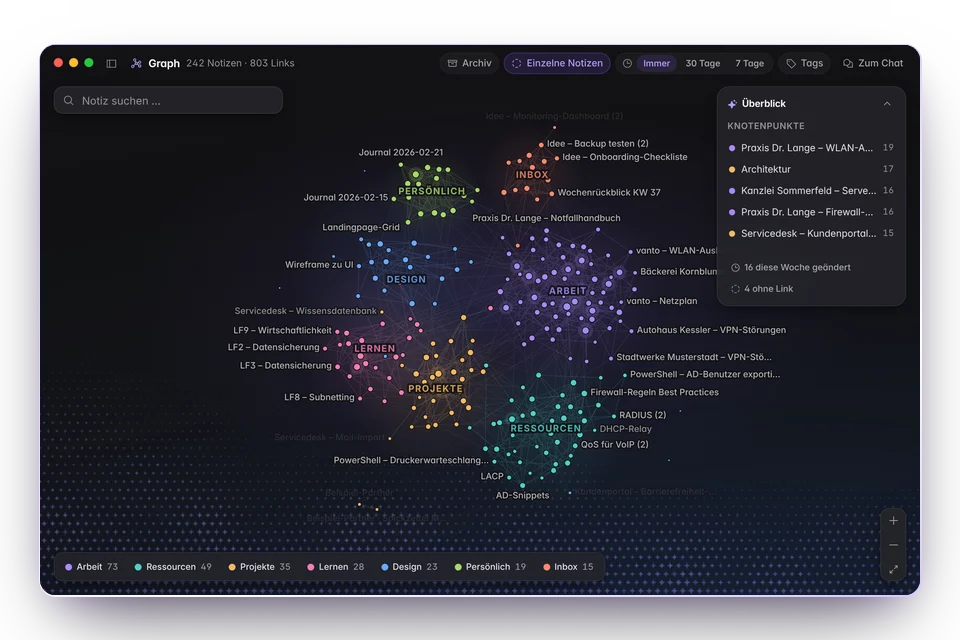
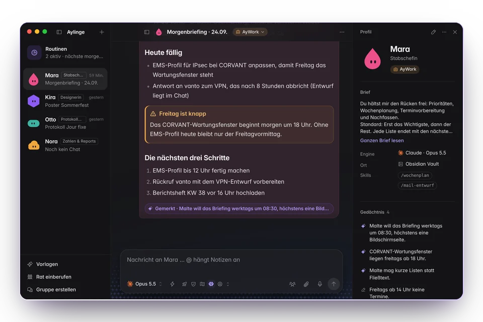
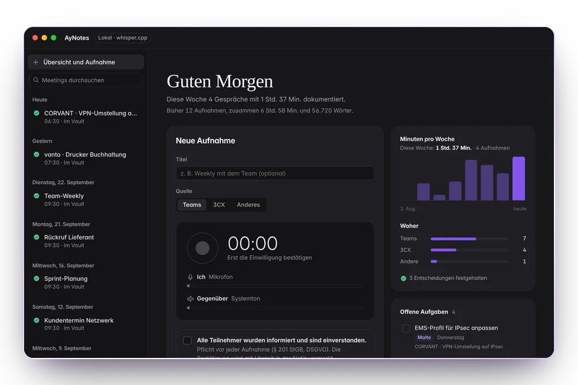
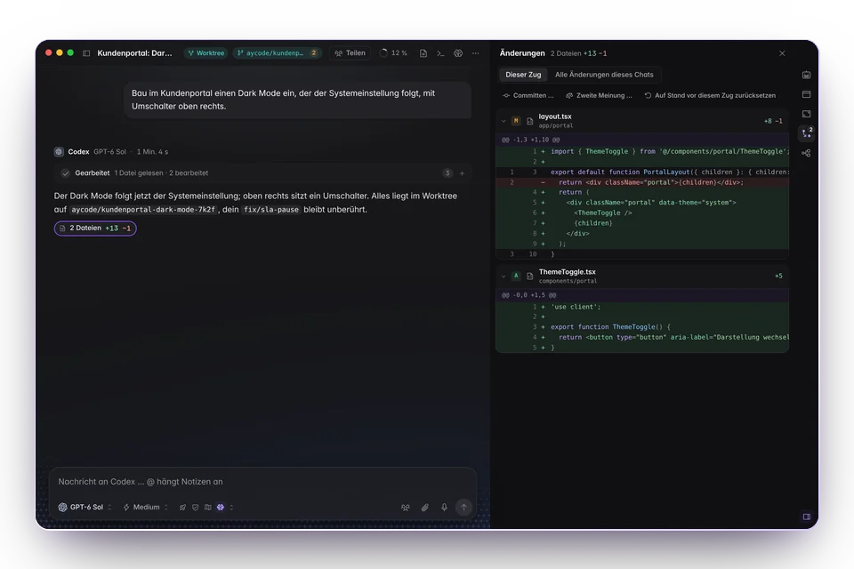
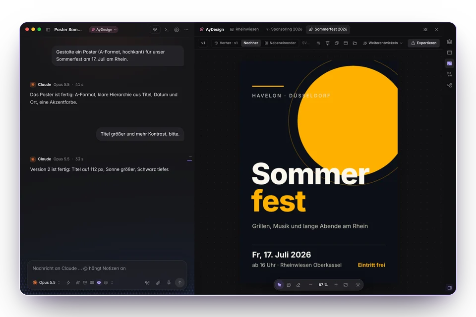
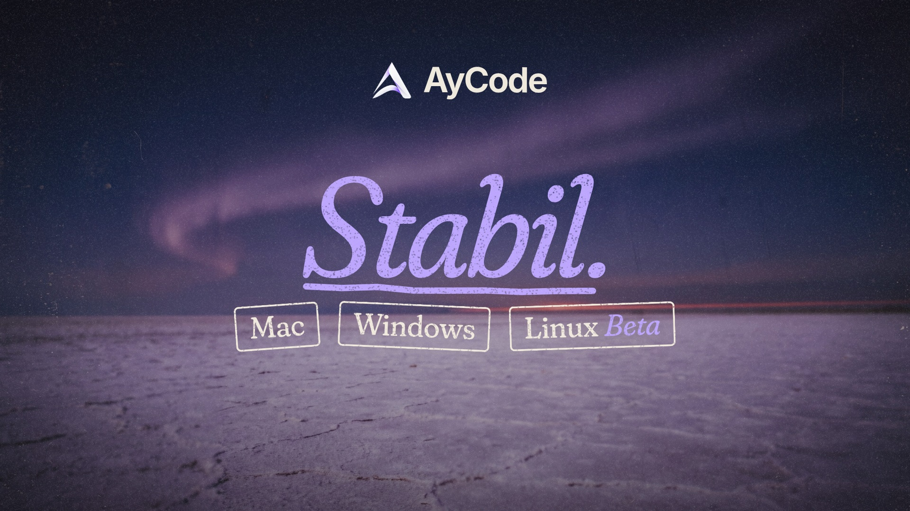

<a href="README.md">English</a> · <b>Deutsch</b>

<a href="https://aycode.ai/de/"><picture>
  <source media="(prefers-color-scheme: dark)" srcset="https://aycode.ai/assets/brand/ribbon-dark.png">
  <source media="(prefers-color-scheme: light)" srcset="https://aycode.ai/assets/brand/ribbon-light.png">
  
</picture></a>

<h1 align="center">Deine Coding-Agenten. In <i>einer ruhigen App</i>.</h1>

AyCode lässt Claude Code, Codex, Antigravity, Grok, OpenCode und andere Coding-Agenten nebeneinander in einer Desktop-App laufen, für Mac, Windows und Linux (Beta). Dein Obsidian-Vault wird zum zweiten Gehirn hinter ihren Antworten.

 
Eine echte Aufnahme der App vor einem mit KI erzeugten Abendhimmel.

<table align="center">
<tr>
<td align="center" valign="top" width="25%"><h3>13+</h3>Coding-Agenten in einem Fenster</td>
<td align="center" valign="top" width="25%"><h3>8</h3>Apps, aus denen du umziehst</td>
<td align="center" valign="top" width="25%"><h3>0</h3>weiterverkaufte Tokens</td>
<td align="center" valign="top" width="25%"><h3>Kostenlos</h3>für Mac, Windows und Linux (Beta)</td>
</tr>
</table>

<a href="https://aycode.ai/de/"><b>Website</b></a>&nbsp;&nbsp;·&nbsp; <a href="https://aycode.ai/de/docs/"><b>Doku</b></a>&nbsp;&nbsp;·&nbsp; <a href="https://aycode.ai/de/changelog/"><b>Changelog</b></a>&nbsp;&nbsp;·&nbsp; <a href="https://aycode.ai/de/#tour"><b>Film</b></a>&nbsp;&nbsp;·&nbsp; <a href="https://github.com/Ayont/AyCode/releases"><b>Alle Releases</b></a>

 

<h3 align="center">Deine Agenten schreiben den Code. AyCode hält den Rest <i>ruhig</i>.</h3>

Ein Fenster für deine Modelle, deine Notizen als ihr Gedächtnis, dein Handy als Fernbedienung, dein Team im selben Raum.

<b>Abb. 1</b> · Papier: deine Notizen, so wie du sie geschrieben hast <b>Abb. 2</b> · Horizont: ein ruhiges Fenster für deine Agenten <b>Abb. 3</b> · Kristall: ein zweites Gehirn, das mit jedem Chat wächst

<h2>Was ist AyCode?</h2>

AyCode ist eine Desktop-App (GUI) für Coding-Agenten, für macOS, Windows und Linux (Beta). Statt <b>Claude Code</b>, <b>OpenAI Codex</b>, <b>Antigravity mit Gemini</b>, <b>Grok</b>, <b>OpenCode</b>, <b>Cline</b>, <b>Kimi Code</b> und andere KI-Agenten in einzelnen Terminal-Tabs zu jonglieren, laufen sie nebeneinander in einem ruhigen Fenster: mit Live-Diffs, Freigaben, Git-Worktrees, Projekt-Boards, Modellauswahl, Kostenübersicht und deinen Obsidian-Notizen als Langzeitgedächtnis. Agentic Coding und Vibe Coding, ohne den Überblick zu verlieren.

<h2 align="center">Rund um den <i>Agenten</i> gebaut</h2>

Kontext, Gedächtnis, Review und ein Weg zurück zu deiner Arbeit, von überall.

<table>
<tr>
<td width="50%" valign="top">

<h3>Deine Agenten, ein Fenster</h3>

Claude Code, Codex, Antigravity, Grok, OpenCode, Cline, Kimi, Pi, Z.ai und mehr nebeneinander. Wechsel das Modell mitten im Chat oder schick einen Prompt an mehrere und vergleich die Antworten.

</td>
<td width="50%" valign="top">

<h3>Ein Second Brain aus deinem Vault</h3>

AyCode liest deine Obsidian-Notizen, Links und Tags im Hintergrund und gibt dem Agenten die passenden mit. Der Graph zeigt, wie dein Wissen zusammenhängt.

</td>
</tr>
<tr>
<td width="50%" valign="top">

<h3>Aylinge, deine Agenten-Crew</h3>

Agenten mit Namen, Gedächtnis und Routinen. Steck mehrere in einen Gruppenchat, sprich einen mit @Name an oder alle mit @alle, auch mit gemischten Anbietern.

</td>
<td width="50%" valign="top">

<h3>AyNotes</h3>

Meetings und Telefonate mitschreiben, nur mit Zustimmung aller. Mitschrift, Zusammenfassung und Aufgaben landen als Notiz im Vault.

</td>
</tr>
<tr>
<td width="50%" valign="top">

<h3>Parallel in Worktrees</h3>

Mehrere Agenten gleichzeitig, jeder auf seinem Branch. Sieh die Änderungen Zeile für Zeile, während sie entstehen, kommentier den Diff und lass ein zweites Modell prüfen, bevor du mergst oder einen Pull Request öffnest.

</td>
<td width="50%" valign="top">

<h3>AyWork und AyDesign</h3>

Dokumente, Tabellen, Folien und Poster entstehen live auf einer Leinwand, während der Agent sie schreibt. AyWork öffnet echte Excel-, CSV- und Word-Dateien, und ältere Versionen sind einen Klick entfernt.

</td>
</tr>
</table>

<h3 align="center">Gemacht für die <i>Momente</i> rund um den Code</h3>

<table>
<tr>
<td width="33%" valign="top"><b>Schnellchat</b> <kbd>⌥ Leertaste</kbd> fragt deinen Agenten aus jeder App.</td>
<td width="33%" valign="top"><b>/btw</b> Eine Frage nebenbei, während die Hauptaufgabe weiterläuft.</td>
<td width="33%" valign="top"><b>Die Insel</b> Deine Agenten an der Notch des Mac. Zieh Text, Dateien oder Links darauf, um sie einem Chat zu geben.</td>
</tr>
<tr>
<td width="33%" valign="top"><b>In einen Subagenten hineingehen</b> Klick auf seinen Namen und sieh ihm bei der Arbeit zu. <kbd>Esc</kbd> führt zurück.</td>
<td width="33%" valign="top"><b>Agent dazuholen</b> Gib eine Aufgabe an eine andere Engine. Sie läuft in einem eigenen Chat und meldet sich zurück.</td>
<td width="33%" valign="top"><b>Projekt-Boards</b> Jedes Projekt hat eine eigene Seite mit Board, seinen Chats und seinen Einstellungen.</td>
</tr>
<tr>
<td width="33%" valign="top"><b>Der Rat der Fünf</b> Lass die Gruppe abstimmen. Jeder Ayling antwortet, AyCode zählt die Stimmen.</td>
<td width="33%" valign="top"><b>Diktat</b> Rechte <kbd>⌥</kbd> halten und in jede App sprechen; ein Wörterbuch lernt deine Begriffe.</td>
<td width="33%" valign="top"><b>Computer steuern</b> Im Chat einschalten, und der Agent klickt und tippt für dich. <kbd>Esc</kbd> stoppt ihn.</td>
</tr>
<tr>
<td width="33%" valign="top"><b>Umzug</b> Nimm deine Chats aus T3 Code, Cursor, Cline, Claude Code, Codex und mehr mit.</td>
<td width="33%" valign="top"><b>Team Sessions</b> Live zusammen coden; Gäste machen im Browser mit.</td>
<td width="33%" valign="top"><b>Kosten im Blick</b> Was jeder Agent und jedes Modell kostet, Budgets, die du selbst setzt, und eine Prognose, wann ein Limit erreicht sein könnte.</td>
</tr>
<tr>
<td width="33%" valign="top"><b>Drei Looks</b> Randnotiz, Werkbank oder Leitstand gestalten die Hauptseiten um.</td>
<td width="33%" valign="top"><b>Auf dem Handy</b> Lesen, antworten und freigeben auf iPhone und Apple Watch (Beta in TestFlight) oder Android.</td>
<td width="33%" valign="top"><b>Begleiter</b> Kleine Figuren leisten dir Gesellschaft und reagieren auf das, was deine Agenten tun.</td>
</tr>
</table>

<h2 align="center">AyCode in <i>Bewegung</i></h2>

<a href="https://aycode.ai/de/#tour"><b>▶ Film ansehen</b></a>&nbsp;&nbsp;·&nbsp;&nbsp;1:05 auf aycode.ai 
Die App-Aufnahmen sind echt. Abendszenen, Hintergründe, Stimmen und Musik sind mit KI erzeugt. Linux ist noch Beta. Unter Windows 11 mit aktivierter intelligenter App-Steuerung startet der Installer noch nicht, weil er noch kein Windows-Zertifikat trägt.

<h2 align="center">Die Agenten, die du <i>schon</i> nutzt</h2>

<b>Claude Code</b> · <b>Codex</b> · <b>Antigravity</b> mit Gemini · <b>Cursor</b> (Vorschau) · <b>Grok</b> · <b>OpenCode</b> · <b>Cline</b> · <b>Kimi Code</b> · <b>Pi</b> · <b>Mistral Vibe</b> · <b>Z.ai</b> · <b>DeepSeek</b> · <b>Hermes</b> · <b>Muse Code</b> · <b>Venice</b> (nur Chat) · lokale Modelle über <b>Ollama</b> oder <b>LM Studio</b>

Einmal pro Anbieter anmelden oder einen API-Schlüssel eintragen. AyCode startet deren Werkzeuge auf deinem Computer, und dein gewählter Modellanbieter erhält die Eingaben und den Kontext, die du sendest. <b>Keine weiterverkauften Tokens.</b>

<picture>
  <source media="(prefers-color-scheme: dark)" srcset="https://aycode.ai/assets/look/schwarm.webp">
  <source media="(prefers-color-scheme: light)" srcset="https://aycode.ai/assets/home/schwarm-morgen.webp">
  
</picture>

<h2 align="center">Hol dir <i>AyCode</i></h2>

Kostenlos für Mac, Windows und Linux (Beta). Danach aktualisiert sich AyCode selbst.

<table>
<tr><th>System</th><th>Voraussetzungen</th><th>Datei</th></tr>
<tr><td><b>macOS</b></td><td>Apple Silicon (M1 oder neuer), macOS 12 oder neuer</td><td><code>.dmg</code></td></tr>
<tr><td><b>Windows</b></td><td>Windows 10 oder 11, 64 Bit</td><td><code>.exe</code>-Installer oder portabel als <code>.zip</code></td></tr>
<tr><td><b>Linux</b> (Beta)</td><td>64 Bit (x86_64): Ubuntu, Debian, Fedora und andere</td><td><code>.AppImage</code> oder <code>.deb</code></td></tr>
<tr><td><b>iPhone & Apple Watch</b></td><td>iOS 18+ · watchOS 11+ · ein erreichbarer AyCode-Computer</td><td><a href="https://testflight.apple.com/join/b5zYjCHJ">Beta in TestFlight</a>, Apples Freigabe steht aus</td></tr>
<tr><td><b>Android</b></td><td>Chats und Freigaben unterwegs · ein erreichbarer AyCode-Computer</td><td><code>.apk</code> im <a href="https://github.com/Ayont/AyCode/releases/latest">neuesten Release</a></td></tr>
</table>

- <b>Mac:</b> mit Developer ID signiert und von Apple notarisiert, daher öffnet es ohne Umweg über die Systemeinstellungen.
- <b>Windows:</b> oder in PowerShell: <code>irm https://aycode.ai/install.ps1 | iex</code>. Für dein Konto, ohne Administratorrechte: Die Zeile prüft die Signatur und installiert ohne Warnfenster. Beim Download im Browser warnt SmartScreen eventuell: <i>Weitere Informationen → Trotzdem ausführen</i>. Unter Windows 11 mit aktivierter intelligenter App-Steuerung startet der Installer noch nicht, weil er noch kein Windows-Zertifikat trägt.
- <b>Linux:</b> AppImage ausführbar machen (<code>chmod +x</code>) und starten, oder das .deb mit apt installieren. Linux ist noch Beta.

Jedes Update ist signiert und geprüft: Zu jedem Release gehören <code>SHA256SUMS</code> und <code>SHA256SUMS.sig</code>, und AyCode installiert ein Update nur mit gültiger Signatur.

<h2 align="center">In <i>drei</i> Schritten startklar</h2>

<table>
<tr>
<td width="33%" valign="top" align="center"><h3>1</h3><b>Laden</b> Wähl dein System auf <a href="https://aycode.ai/de/#download">aycode.ai</a>. Die Datei kommt direkt aus diesem Repository.</td>
<td width="33%" valign="top" align="center"><h3>2</h3><b>Öffnen</b> Am Mac AyCode in Programme ziehen. Unter Windows den Installer starten. Unter Linux das AppImage starten oder das .deb installieren.</td>
<td width="33%" valign="top" align="center"><h3>3</h3><b>Bei deinen Agenten anmelden</b> Einmal pro Anbieter, oder einen API-Schlüssel eintragen. AyCode findet deinen Obsidian-Vault und die Chats, die du schon hast.</td>
</tr>
</table>

<h2 align="center">Was ist <i>neu</i></h2>

<table>
<tr><td width="96" align="center"><a href="https://github.com/Ayont/AyCode/releases/tag/v7.4.12"><b>7.4.12</b></a> 1. Nov.</td><td>Jedes Projekt bekommt eine eigene Seite mit Board, dazu drei neue Looks, Dateien auf der Insel des Mac landen im Chat, und zwei neue Anbieter: Muse Code und Venice.</td></tr>
<tr><td width="96" align="center"><a href="https://github.com/Ayont/AyCode/releases/tag/v7.4.11"><b>7.4.11</b></a> 26. Okt.</td><td>Ein Koordinator schlägt einen Plan vor, bevor Agenten in getrennten Arbeitskopien an einem Vorhaben arbeiten, Skills stehen direkt im Eingabefeld, und Duo kommt aufs iPhone.</td></tr>
<tr><td width="96" align="center"><a href="https://github.com/Ayont/AyCode/releases/tag/v7.4.10"><b>7.4.10</b></a> 24. Okt.</td><td>In einen Subagenten hineingehen und ihm zusehen, die Agenten eines Chats gesammelt in einem Panel, über Engines hinweg, eine ruhigere Seitenleiste und eine iPhone-Verbindung, die auch bei sehr großen Chats hält.</td></tr>
<tr><td width="96" align="center"><a href="https://github.com/Ayont/AyCode/releases/tag/v7.4.9"><b>7.4.9</b></a> 23. Okt.</td><td>OpenCode 2 läuft wieder, sehr lange Chats öffnen sich seitenweise, ein Chat kann aus einem gewählten Branch oder einem vorhandenen Worktree starten, und ein Review-Modus nur zum Lesen.</td></tr>
<tr><td width="96" align="center"><a href="https://github.com/Ayont/AyCode/releases/tag/v7.4.8"><b>7.4.8</b></a> 18. Okt.</td><td>Cursor als Anbieter (Vorschau), GitLab-Projekte, Anmeldung im Browser für entfernte Konnektoren und eine Verbrauchsprognose.</td></tr>
<tr><td width="96" align="center"><a href="https://github.com/Ayont/AyCode/releases/tag/v7.4.6"><b>7.4.6</b></a> 11. Okt.</td><td>Ein einfacherer Start, eine übersichtlichere Seitenleiste, AppShot unter Windows und ein geführtes Koppeln des Handys per QR-Code.</td></tr>
</table>

<a href="https://aycode.ai/de/changelog/"><b>Alle Versionshinweise →</b></a>

<h2>Häufige Fragen</h2>

<b>Ist AyCode kostenlos?</b>

 
Ja, AyCode ist kostenlos zum Laden und Nutzen. Die Agenten laufen so, wie sie auf deinem Rechner angemeldet sind, oder mit deinen eigenen API-Schlüsseln, und AyCode verkauft keine Tokens weiter. Beim gewählten Anbieter können Kosten für dessen Dienste entstehen.
  

<b>Welche Coding-Agenten unterstützt AyCode?</b>

 
Claude Code, Codex, Antigravity mit Gemini, Grok, OpenCode, Cline, Kimi Code, Pi, Mistral Vibe, Z.ai, DeepSeek, Hermes, Muse Code und lokale Modelle über Ollama oder LM Studio, jeder im eigenen Chat oder nebeneinander. Cursor läuft als Vorschau, und Venice bringt gehostete Chat-Modelle mit.
  

<b>Was ist anders, als die Agenten im Terminal laufen zu lassen?</b>

 
AyCode startet dieselben offiziellen Werkzeuge, angemeldet so wie auf deinem Rechner. Drumherum bekommst du ein Fenster: Live-Diffs und Freigaben, Git-Worktrees, Projekt-Boards, deine Notizen als Gedächtnis, Verbrauch und Limits auf einen Blick und dein Handy als Fernbedienung.
  

<b>Ist AyCode Open Source?</b>

 
Nein. Der Quellcode ist privat. Dieses Repository enthält die Installer, den Update-Feed und die Versionshinweise.
  

<b>Verlässt mein Code meinen Computer?</b>

 
Die Agenten-Werkzeuge laufen auf deinem Computer. Bei einem externen Modell erhält dessen Anbieter deine Eingaben und darin enthaltenen Code oder Notizen. Die AyCode Cloud ist freiwillig: Sie trägt die Handy-Verbindung von unterwegs, Ende-zu-Ende-verschlüsselte Sicherungen und Team Sessions.
  

<b>Brauche ich Obsidian?</b>

 
Nein. AyCode liest einen Obsidian-Vault, wenn du einen hast, und läuft auch ohne.
  

<b>Auf welchen Systemen läuft AyCode?</b>

 
Auf Macs mit Apple Silicon, unter Windows 10 und 11 und als Beta unter 64-Bit-Linux (AppImage oder .deb). Die Begleit-App für iPhone und Apple Watch ist in TestFlight und wartet auf Apples Freigabe, die für Android liegt als APK im neuesten Release. Beide verbinden sich mit deinem laufenden AyCode-Computer.
  

<b>Wo ist die Doku?</b>

 
<a href="https://aycode.ai/de/docs/">aycode.ai/de/docs</a> führt Kapitel für Kapitel durch die App.
  

 

Spart dir AyCode ein paar Terminal-Tabs, hilft ein <b>⭐ Stern</b> anderen Entwicklern, es zu finden. Bei jedem Release Bescheid bekommen? Oben auf dieser Seite <b>Watch → Custom → Releases</b> wählen.

<b>Weitersagen:</b>&nbsp; <a href="https://x.com/intent/post?text=AyCode%3A%20deine%20KI-Coding-Agenten%20(Claude%20Code%2C%20Codex%2C%20Antigravity%2C%20Grok%2C%20OpenCode%20%E2%80%A6)%20in%20einer%20ruhigen%20Desktop-App&url=https%3A%2F%2Fgithub.com%2FAyont%2FAyCode">X</a>&nbsp;&nbsp;·&nbsp; <a href="https://www.reddit.com/submit?url=https%3A%2F%2Fgithub.com%2FAyont%2FAyCode&title=AyCode%3A%20deine%20KI-Coding-Agenten%20(Claude%20Code%2C%20Codex%2C%20Antigravity%2C%20Grok%2C%20OpenCode%20%E2%80%A6)%20in%20einer%20ruhigen%20Desktop-App">Reddit</a>&nbsp;&nbsp;·&nbsp; <a href="https://news.ycombinator.com/submitlink?u=https%3A%2F%2Fgithub.com%2FAyont%2FAyCode&t=AyCode%3A%20deine%20KI-Coding-Agenten%20(Claude%20Code%2C%20Codex%2C%20Antigravity%2C%20Grok%2C%20OpenCode%20%E2%80%A6)%20in%20einer%20ruhigen%20Desktop-App">Hacker News</a>&nbsp;&nbsp;·&nbsp; <a href="https://www.linkedin.com/sharing/share-offsite/?url=https%3A%2F%2Fgithub.com%2FAyont%2FAyCode">LinkedIn</a>

<picture>
  <source media="(prefers-color-scheme: dark)" srcset="https://aycode.ai/assets/look/see-abend-1600.webp">
  <source media="(prefers-color-scheme: light)" srcset="https://aycode.ai/assets/look/see-morgen-1600.webp">
  
</picture>

<a href="https://aycode.ai/de/">aycode.ai</a>&nbsp;&nbsp;·&nbsp; <a href="https://aycode.ai/de/docs/">Doku</a>&nbsp;&nbsp;·&nbsp; <a href="https://aycode.ai/de/changelog/">Changelog</a>&nbsp;&nbsp;·&nbsp; <a href="https://x.com/AyCodeAI">X @AyCodeAI</a>&nbsp;&nbsp;·&nbsp; <a href="https://www.instagram.com/aycodeai/">Instagram @aycodeai</a>&nbsp;&nbsp;·&nbsp; <a href="https://www.linkedin.com/company/aycodeai/">LinkedIn</a>&nbsp;&nbsp;·&nbsp; <a href="https://aycode.ai/de/impressum/">Impressum</a>&nbsp;&nbsp;·&nbsp; <a href="https://aycode.ai/de/datenschutz/">Datenschutz</a>

Hintergrundbilder und Filmszenen sind mit KI erzeugt. Die App-Bilder sind echte Aufnahmen.

